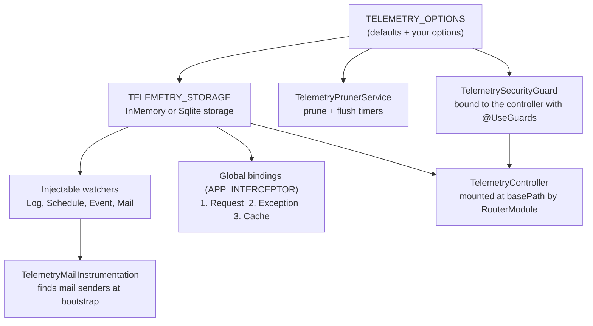
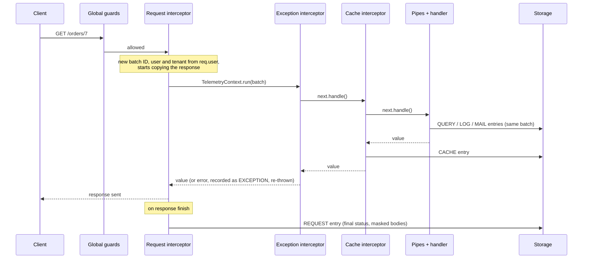
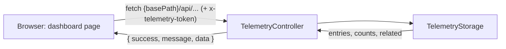

NestJS Telemetry is a Nest dynamic module plus a static page. Watchers write entries to a storage; a controller exposes the storage over HTTP; the page polls the controller.

## Module registration

`TelemetryModule.forRoot()` and `forRootAsync()` return the same global module:

- **Options** are resolved once: `forRoot()` merges them immediately, `forRootAsync()` in a factory provider. Every other provider reads the resolved `TELEMETRY_OPTIONS`, so both entry points behave identically.
- **Storage** is created by a factory from `storage`: `SqliteTelemetryStorage(sqlitePath)` or `InMemoryTelemetryStorage(maxEntries)`.
- **Global bindings**: three interceptors, each built by a factory that returns a pass-through when its switch is off. Registration order is execution order: the request interceptor is outermost, so the context it creates is visible to the other two.
- **Access token**: `TelemetrySecurityGuard` is bound to `TelemetryController` with `@UseGuards`, not to the application, so it runs on the dashboard's routes only, wherever they are mounted, and reads the token from `TELEMETRY_OPTIONS`. Your routes never reach it.
- **Passive watchers** (log, schedule, event, mail) are providers your code injects. The mail instrumentation walks the providers at `onApplicationBootstrap` and instruments the mail senders it recognises.
- **Routes**: `RouterModule.register()` mounts `TelemetryController` at `basePath`; `DiscoveryModule` gives the mail instrumentation access to the providers.
- **Exports**: `TELEMETRY_STORAGE`, `TELEMETRY_USER_PROVIDER` and the four passive watchers. `TELEMETRY_OPTIONS` is not exported.

## One HTTP request

What the diagram implies:

- Anything that happens **before** the request interceptor (middleware, guards) has no batch and is not recorded as part of the request; a request rejected there is not recorded at all.
- Everything the handler does, including `await`ed work, runs inside `TelemetryContext.run()`, so its entries share the batch. See [Batch correlation](./batch-correlation.md).
- The `REQUEST` entry is written last, when the response finishes, because only then is the status final.

## The dashboard

The page polls three endpoints every five seconds (stats, filter options, and the current list) and fetches related entries when you open one. The controller is a thin layer over the storage interface: every read and write goes through `TelemetryStorage`, which is what makes the two storages interchangeable.

## Where to look in the code

| Piece | File |
| --- | --- |
| Module and bindings | `packages/core/src/telemetry.module.ts` |
| Options and defaults | `packages/core/src/telemetry.options.ts` |
| Storage contract and implementations | `packages/core/src/storage/` |
| Context (AsyncLocalStorage) | `packages/core/src/context/telemetry-context.ts` |
| Watchers | `packages/core/src/watchers/` |
| REST API | `packages/core/src/controller/telemetry.controller.ts` |
| Dashboard | `packages/core/src/dashboard/index.html` |
| ORM integrations | `packages/typeorm/src/`, `packages/prisma/src/` |
