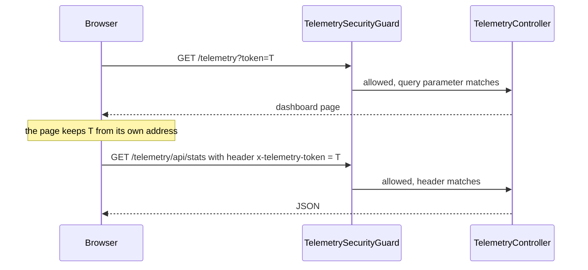
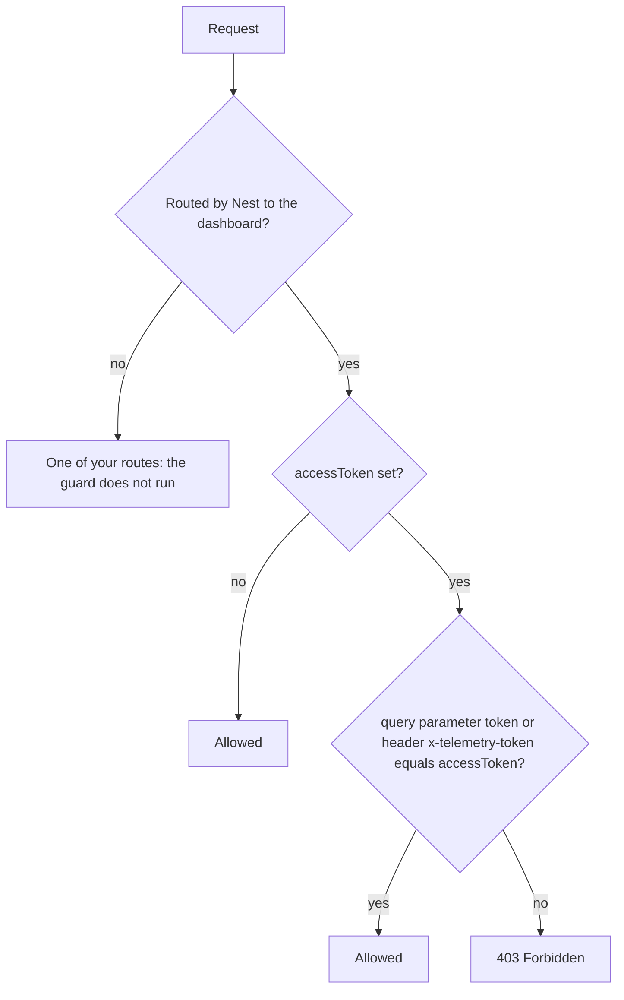

The dashboard and its JSON API show everything the watchers record: request and response bodies, headers, SQL, mail, user identifiers. They can also pause recording and delete entries. The `accessToken` option is the only access control the package provides. This page explains how it works, where it stops, and what to add around it.

## What the token protects

The module serves two things under the dashboard path (`basePath`, `/telemetry` by default):

| Route | What it is |
|-------|------------|
| `GET {basePath}` | The dashboard page: static HTML, no data in it |
| `{basePath}/api/...` | The JSON API the page calls: entries, related entries, stats, status, filters, tags, memory, and the routes that change state: `POST /api/toggle`, `POST /api/flush`, `POST /api/prune`, `POST /api/prune/expired` and `DELETE /api/entries` |

The full list is in the [REST API reference](../reference/rest-api.md). When `accessToken` is set, every one of these routes requires it. When it is not set, none does.

## Set an access token

Pass the token from your environment, never from source code:

```ts title="app.module.ts"
import { Module } from '@nestjs/common';
import { TelemetryModule } from '@nestjs-telemetry/core';

@Module({
  imports: [
    TelemetryModule.forRoot({
      accessToken: process.env.TELEMETRY_TOKEN,
    }),
  ],
})
export class AppModule {}
```

:::warning
If `TELEMETRY_TOKEN` is not set, `accessToken` is `undefined`, the dashboard is open, and nothing tells you so. Outside your own machine, read the token so that a missing value stops the app from starting.
:::

With `@nestjs/config`, `getOrThrow()` does that:

```ts title="app.module.ts"
import { Module } from '@nestjs/common';
import { ConfigModule, ConfigService } from '@nestjs/config';
import { TelemetryModule } from '@nestjs-telemetry/core';

@Module({
  imports: [
    ConfigModule.forRoot(),
    TelemetryModule.forRootAsync({
      imports: [ConfigModule],
      inject: [ConfigService],
      useFactory: (config: ConfigService) => ({
        accessToken: config.getOrThrow<string>('TELEMETRY_TOKEN'),
      }),
    }),
  ],
})
export class AppModule {}
```

See [Async configuration](../getting-started/async-configuration.md) for the rest of `forRootAsync`.

Use a long random value made of URL-safe ASCII characters, so it travels in a query string and in a header without any encoding:

```bash
node -e "console.log(require('crypto').randomBytes(32).toString('hex'))"
```

The token is read once, when the module starts. To rotate it, change the value and restart the app.

## Open the dashboard with the token

Add the token to the dashboard address:

```text
http://localhost:3000/telemetry?token=<your-token>
```

The page reads `token` from its own address and sends it as the `x-telemetry-token` header on every API call it makes. It never adds the token to the API URLs. Moving between views does not change the page address, so the token stays for the whole session, and a reload keeps it. Opening the page without the token answers `403` with Nest's default body (`{"message":"Forbidden resource","error":"Forbidden","statusCode":403}`); there is no login form.



Scripts and other API clients send the same header:

```bash
curl -H "x-telemetry-token: $TELEMETRY_TOKEN" http://localhost:3000/telemetry/api/status
```

The `token` query parameter is accepted on the API routes too, but the header keeps the token out of access logs. If you serve the page from another location (see [Serving and embedding the dashboard](../dashboard/embedding.md)), it still takes the token from the `token` parameter of its own address.

## How the guard decides

`TelemetrySecurityGuard` is bound to the dashboard's controller with `@UseGuards`, not to your whole application. Nest runs it on exactly the requests it routes to the dashboard page and its API, and on nothing else. It never looks at the path: whatever spelling, case, global prefix, mount point or HTTP adapter brought the request there, the same check applies.



What that means in practice, with the token `T` and the default `basePath`:

| Request | Result |
|---------|--------|
| `GET /telemetry` | `403` |
| `GET /telemetry?token=T` | `200` |
| `GET /telemetry/api/stats` with `x-telemetry-token: T` | `200` |
| `GET /telemetry/api/stats?token=T` | `200` |
| `GET /Telemetry/api/stats`, a case variant Express routes to the dashboard | `403` |
| `GET /telemetry/api/stats` with `Authorization: Bearer T` | `403`: the `Authorization` header is not read |
| `GET /telemetry/api/stats?token=T&token=T` | `403`: a repeated parameter arrives as a list, not a string |
| `GET /telemetry-reports`, one of your routes | not checked |
| `GET /orders` | not checked |

- The comparison is exact and case-sensitive. It runs in constant time, on digests of both values, so the response time shows neither how much of a guess was right nor how long the token is.
- The header name is not case-sensitive (Node lower-cases header names); its value must match exactly.
- The query parser decodes the parameter before the comparison: `+` becomes a space and `%2B` a plus sign. A hex token avoids the question.
- `TelemetrySecurityGuard` is exported from `@nestjs-telemetry/core`, but you never need to register it: the dashboard's controller already uses it. It reads `accessToken` from the module options.

## When no token is configured

`accessToken` defaults to `''`. With an empty or missing token the guard lets every request through. The page and every API route then answer to anyone who can reach your app, including the routes that pause recording, prune and delete entries.

That is fine on a laptop where nobody else can reach the port. Set a token everywhere else, shared development and staging environments included. Even on your own machine, an open dashboard cannot tell your requests from the ones another web page makes your browser send to `localhost`.

## Where the token is checked

On every route of the dashboard, wherever it is mounted. None of these settings changes that:

- **A global prefix.** With `app.setGlobalPrefix('api/v1')` the dashboard moves to `/api/v1/telemetry`, and the token is asked there, with no other setting. `externalBasePath` plays no part in the token; it only keeps the dashboard's own calls out of the recorded requests (see [Global prefix and externalBasePath](./global-prefix.md)).
- **`forRootAsync` with a custom path.** The routes are mounted with the `basePath` you pass next to `useFactory`, or at `/telemetry` when you pass none. A `basePath` returned by the factory does not move them. Wherever they end up, the token is asked there:

  | `basePath` next to `useFactory` | `basePath` returned by `useFactory` | Dashboard served at |
  |---|---|---|
  | not set | not set | `/telemetry` |
  | `/admin/telemetry` | `/admin/telemetry` | `/admin/telemetry` |
  | not set | `/admin/telemetry` | `/telemetry` |
  | `/admin/telemetry` | not set | `/admin/telemetry` |

  Pass the same value in both places anyway: the request watcher uses the one the factory returns to recognise the dashboard's own calls.
- **The spelling of the path.** `basePath: 'telemetry'`, without its leading slash, and `basePath: '/telemetry/'`, with a trailing slash, both serve the dashboard at `/telemetry`, behind the token. Write it with a leading slash and without a trailing one all the same, for the request watcher's sake.
- **Case variants.** Express routes without regard to case, so `/TELEMETRY/api/entries` reaches the dashboard API. It goes through the same check.
- **Fastify.** The guard reads only the `token` query parameter and the `x-telemetry-token` header, which a Fastify request has too. The package's test suite runs on the Express adapter only.

Your own routes never reach the guard, including the ones whose path starts with the same characters as the dashboard's: `/telemetry-reports` and `/telemetryx` answer as if the module were not there.

## Your own global guards

Nest runs every global guard on every route, the dashboard routes included, and a request goes through only when all of them allow it. That has consequences in both directions:

- **An app-wide JWT guard blocks the dashboard.** A browser does not add `Authorization: Bearer ...` to a page it opens, and the dashboard's API calls only add `x-telemetry-token`. You get `401` from your guard, even with the right telemetry token. A `401` means another guard refused the request; `TelemetrySecurityGuard` answers `403`.
- **A guard that authenticates with a cookie** (a session) lets the dashboard work for users who are logged in: the browser sends the cookie with the page and with the API calls, which are same-origin. Those users need both your session and the telemetry token.
- **A global rate limiter** such as `ThrottlerGuard` counts the dashboard's polling: an open tab calls three API routes every five seconds. Exclude the dashboard path from it (`@nestjs/throttler` has a `skipIf` option) or allow for that rate.

To let the dashboard through a JWT guard, skip your check on the dashboard path and leave the token to `TelemetrySecurityGuard`. The dashboard controller is not part of the package's public exports, so a `@Public()`-style decorator cannot be put on it; match the request path instead:

```ts title="jwt-auth.guard.ts"
import { ExecutionContext, Injectable } from '@nestjs/common';
import { AuthGuard } from '@nestjs/passport';

// The dashboard path as requests carry it, global prefix included.
const TELEMETRY_PATH = '/telemetry';

function isTelemetryRequest(context: ExecutionContext): boolean {
  if (context.getType() !== 'http') return false;
  const path: string = context.switchToHttp().getRequest().path ?? '';
  return path === TELEMETRY_PATH || path.startsWith(`${TELEMETRY_PATH}/`);
}

@Injectable()
export class JwtAuthGuard extends AuthGuard('jwt') {
  canActivate(context: ExecutionContext) {
    // TelemetrySecurityGuard checks the access token on these paths.
    if (isTelemetryRequest(context)) return true;
    return super.canActivate(context);
  }
}
```

:::danger
Skip your guard on the dashboard path only when `accessToken` is set. Without a token, your guard was the only thing in front of the dashboard.
:::

Keep the `/` boundary of the comparison, as above, so that none of your own routes that merely start with the same characters (`/telemetry-reports`) skips your guard. A case variant of the dashboard path that the comparison does not match still has to pass your guard, and then the telemetry token, so it opens nothing.

## Hardening checklist

- **Keep the dashboard off the public internet.** Allow the dashboard path only from your VPN or office network at the reverse proxy or ingress, with a rule that matches regardless of case. The token is a second line, not the only one.
- **Serve it over HTTPS only.** The token travels in a header and in the page address.
- **Keep the token out of logs.** The page address carries `?token=`, so your proxy, ingress and HTTP logging middleware record it. Mask the `token` parameter in those logs. The request watcher leaves the dashboard's own calls out, and masks a `token` parameter wherever it records one.
- **Consider letting your proxy hold the token.** The guard accepts the header on the page request too. A proxy that authenticates your team (single sign-on) and adds `x-telemetry-token` to every request under the dashboard path means the browser never sees the token: open the page without `?token=`, and the proxy supplies the header on each API call as well.
- **Remember what one token grants.** There are no users, roles or read-only access, and no audit of who looked: anyone with the token can read every entry, pause recording and delete entries. Rate-limit the dashboard path at the proxy; the guard has no lockout.
- **Know what the page loads.** The dashboard page loads Tailwind CSS from `cdn.tailwindcss.com` and Alpine.js from `cdn.jsdelivr.net`, without integrity attributes. Those scripts run with access to the page, the token in its address and every entry it shows.
- **Treat what is stored as sensitive.** Masking hides credentials, not personal data; see [Data masking](../concepts/data-masking.md) for what is stored as is.
